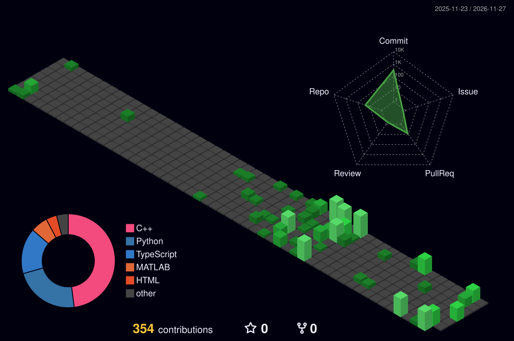

<!-- HEADER -->


<div align="center">

<a href="https://github.com/Charon-68">
  
</a>

`ᚠ ᚢ ᚦ ᚩ ᚱ ᚳ ᚷ ᚹ ᚻ ᚾ ᛁ ᛄ ᛇ ᛈ ᛉ ᛋ ᛏ ᛒ ᛖ ᛗ ᛚ ᛝ ᛟ ᛞ ᚪ ᚫ ᚣ ᛡ ᛠ`

</div>

<br/>

```console
root@charon:~$ cat identity.txt
```

```yaml
handle:    Charon-68
role:      builder / breaker / puzzle-solver      # edit me
focus:     [ AI, security, systems ]              # edit me
status:    online // watching the signal
motto:     "Through the dark, the code remembers."
```

<br/>

## `> 3D contribution matrix`

<div align="center">
  
</div>

<br/>

## `> arsenal`

<div align="center">


</div>

<br/>

## `> telemetry`

<div align="center">


</div>

<br/>

## `> the snake feeds`

<div align="center">
  <picture>
    <source media="(prefers-color-scheme: dark)" srcset="https://raw.githubusercontent.com/Charon-68/Charon-68/output/github-snake-dark.svg" />
    
  </picture>
</div>

<br/>

<div align="center">

```text
01000111 01101111 01101111 01100100 00100000 01101100 01110101 01100011 01101011
```


</div>

<!-- FOOTER -->

