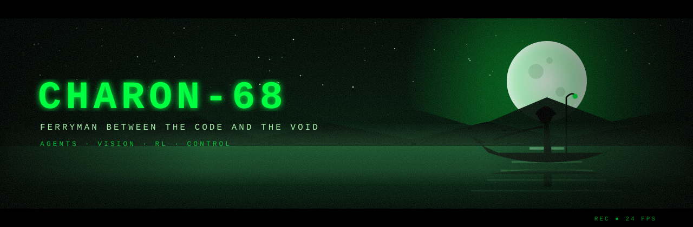

<!-- HEADER -->


<div align="center">

<a href="https://github.com/Charon-68">
  
</a>

`ᚠ ᚢ ᚦ ᚩ ᚱ ᚳ ᚷ ᚹ ᚻ ᚾ ᛁ ᛄ ᛇ ᛈ ᛉ ᛋ ᛏ ᛒ ᛖ ᛗ ᛚ ᛝ ᛟ ᛞ ᚪ ᚫ ᚣ ᛡ ᛠ`

</div>

## `> 3D contribution matrix`

<div align="center">
  
</div>

## `> featured payloads`

```console
root@charon:~$ ls -lt ~/projects | head
```

| | project | what it does | stack |
|---|---|---|---|
| 🛰️ | **[Turret Control System](https://github.com/Charon-68/Turrent-Control-System_ME319)** | Predictive tracking and turret control through radar blackouts. **1000/1000** held-out engagements intercepted, 9,198 of 9,204 pulses on target, 25/25 checks in CI. | `Octave` `MATLAB` `Control` |
| 🧠 | **[AI Apprentice](https://github.com/Charon-68/Jarvis-HackNation)** | Hack-Nation x ElevenLabs build: captures how an expert support engineer triages, turns it into a verified Work Map, then coaches a new hire on an unseen ticket. | `TypeScript` `Voice AI` `Agents` |
| 🕵️ | **[AI Image Forensics](https://github.com/Charon-68/Cross-Generator-AI-Image-Forensics-)** | CPU-only detector for AI-generated images, with explanations. **0.901 AUROC** on a source-disjoint test set (0.874 under JPEG-50). Hand-tuned baseline scored 0.358, so it was replaced by a learned model. | `Python` `LightGBM` `SHAP` |
| 🗣️ | **[VasooliMitra](https://github.com/Charon-68/VasooliMitra)** | Voice-first AI CFO for Indian small businesses. Speak in Hindi to log sales, udhari and GST. WhatsApp-connected. | `Next.js` `FastAPI` `Supabase` `Whisper` |
| ⚔️ | **[CodeDuel](https://github.com/Charon-68/CodeDuel)** | Competitive programming platform with real-time 1v1 duels, async code judging in Docker sandboxes, live verdict streaming. | `Next.js` `Express` `BullMQ` `Redis` `Postgres` |
| 🔎 | **[Agentic Code Retrieval](https://github.com/Charon-68/Agentic-Code-Retrieval-System)** | Agentic RAG over code repos: hybrid search, AST-aware parsing, ReAct-style reasoning. | `Python` `LlamaIndex` `ChromaDB` |
| 🧬 | **[PINN Pipeline](https://github.com/Charon-68/pinn_work)** | Generates, validates, trains and benchmarks physics-informed neural networks from equations, with mixed-precision benchmarking. | `Python` `PyTorch` |
| 📈 | **[DeepRL Stock Trading](https://github.com/Charon-68/DeepRL-StockTrading)** | DQN vs DDPG for multi-asset trading with transaction costs and risk-aware rewards. | `Python` `FinRL` `SB3` |
| 🔗 | **[EntityMesh](https://github.com/Charon-68/EntityMesh-Amazon_ML_Hackathon)** | Entity resolution across 3 noisy business data sources. Amazon ML Challenge. | `Python` `ML` |
| 🌄 | **[DepthWizard](https://github.com/Charon-68/DepthWizard-SIH_175)** | Single-view height estimation and 3D flythrough from satellite imagery. SIH. | `PyTorch` `GAMUS` |
| 🌿 | **[Portfolio](https://github.com/Charon-68/portfolio-Shourya)** | Interactive portfolio inside a procedural Three.js valley with custom GLSL shaders. [Live](https://shouryasaxena.vercel.app) | `Three.js` `React 19` `Vite` |

<details>
<summary><code>> more: learning in public</code></summary>

<br/>

- [Multimodal Transformer from scratch](https://github.com/Charon-68/SOC_MultiModal_Transformer_24b2222): ViT, CLIP-style dual encoder and cross-attention models in PyTorch (IIT Bombay Seasons of Code)
- [NLP Bootcamp](https://github.com/Charon-68/NLP_Bootcamp): sentence transformers, PEFT fine-tuning, dense retrieval, reranking, RAG, MCP
- [CV Bootcamp](https://github.com/Charon-68/CV_Bootcamp) and [YOLOv5 object detection](https://github.com/Charon-68/object-detection-by-yolov5)
- [Leetmaxxing](https://github.com/Charon-68/Leetmaxxing): LeetCode grind in C++
- [Fatigue strength predictor](https://github.com/Charon-68/fatigue-strength-predictor): XGBoost/RF plus Pareto alloy design (fork)

</details>

## `> arsenal & telemetry`

<div align="center">


</div>

## `> activity signal`

<div align="center">
  
</div>

## `> the snake feeds`

<div align="center">
  <picture>
    <source media="(prefers-color-scheme: dark)" srcset="https://raw.githubusercontent.com/Charon-68/Charon-68/output/github-snake-dark.svg" />
    
  </picture>
</div>

<br/>

<div align="center">

```text
01000111 01101111 01101111 01100100 00100000 01101100 01110101 01100011 01101011
```


</div>

<!-- FOOTER -->

